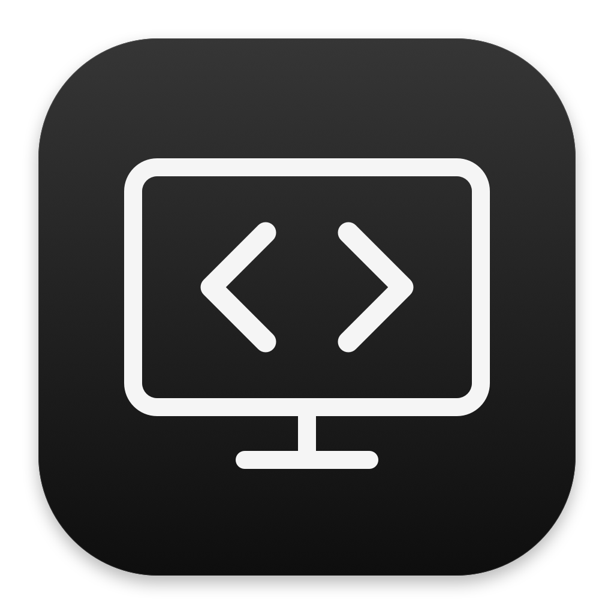

  

<h1 align="center">AnywhereHost</h1>

  A self hosted Codex backend for AnyWhereCoding
   
  Powered by iroh

  <a href="https://github.com/Xingsandesu/AnywhereHost/releases"><strong>Download for Mac</strong></a>
  &emsp;
  <a href="Docs/README.md">Documentation</a>
  &emsp;
  <a href="README.zh-CN.md">简体中文</a>

 

Run Codex on your Mac and connect from AnyWhereCoding on your iPhone 
Keep your existing projects and session history

## Under the hood

| Component | Implementation |
| --- | --- |
| Host | SwiftUI app with a Rust backend |
| Transport | Native iroh streams with direct connections and a self hosted relay |
| Encryption | Authenticated endpoints and end to end encryption |
| Relay | Forwards encrypted traffic without access to its contents |
| Access | Single use QR pairing with revocable device access |
| macOS releases | Signed and notarized before publication |

[Architecture](Docs/ARCHITECTURE.md) &emsp; [Protocol](Docs/API.md) &emsp; [Security](Docs/SECURITY.md) &emsp; [Build and release](Docs/DISTRIBUTION.md)

## Connect your phone

- Install Codex and AnywhereHost on your Mac
- Open the Host and choose the option to pair a new client
- Scan the QR code in AnyWhereCoding

Keep your Mac awake and the Host running during remote use 
Enable screen sharing separately if you need remote desktop access

 

[Source](backend/src) &emsp; [Contributing](CONTRIBUTING.md) &emsp; [Changelog](CHANGELOG.md) &emsp; [Apache License](LICENSE)
