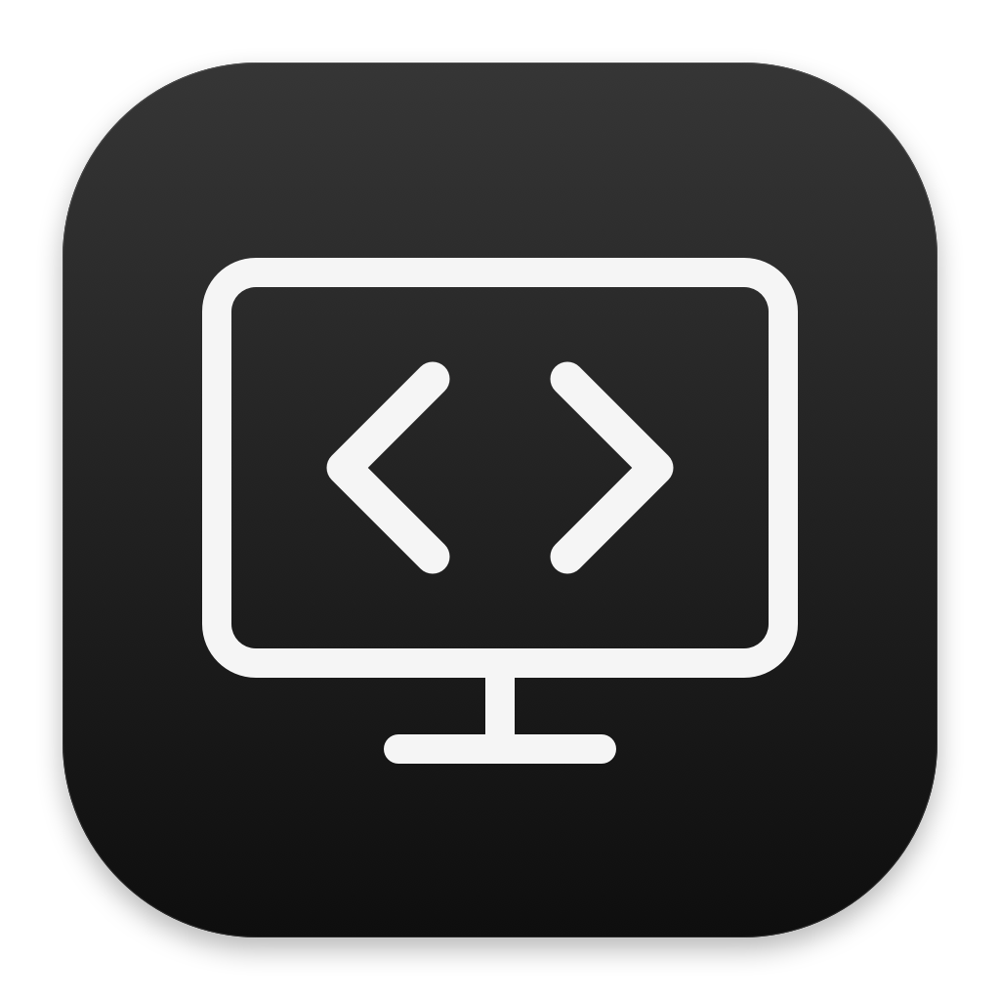

  

<h1 align="center">AnywhereHost</h1>

  AnyWhereCoding 的自托管 Codex 后端
   
  Powered by iroh

  <a href="https://github.com/Xingsandesu/AnywhereHost/releases"><strong>下载 Mac 版</strong></a>
  &emsp;
  <a href="Docs/README.md">文档</a>
  &emsp;
  <a href="README.md">English</a>

 

在 Mac 上运行 Codex 并沿用已有项目和会话 
通过 iPhone 上的 AnyWhereCoding 继续任务与处理审批

## 技术与安全

| 组件 | 实现 |
| --- | --- |
| Host | SwiftUI 界面与 Rust 后端 |
| 传输 | iroh 原生流支持直连与自建 relay 中继 |
| 加密 | 端点身份认证与端到端加密 |
| 中继 | 仅转发加密流量 无法读取内容 |
| 授权 | 一次性扫码配对 可在 Host 撤销设备访问 |
| macOS 发布 | 正式包发布前完成签名与公证 |

[架构](Docs/ARCHITECTURE.md) &emsp; [协议](Docs/API.md) &emsp; [安全机制](Docs/SECURITY.md) &emsp; [构建与发布](Docs/DISTRIBUTION.md)

## 连接手机

- 在 Mac 上安装 Codex 和 AnywhereHost
- 打开 Host 并选择配对新客户端
- 在 AnyWhereCoding 扫描二维码

远程使用时保持 Mac 唤醒与 Host 运行 
需要远程桌面时再单独启用屏幕共享

 

[源码](backend/src) &emsp; [参与开发](CONTRIBUTING.md) &emsp; [更新记录](CHANGELOG.md) &emsp; [Apache 许可证](LICENSE)
